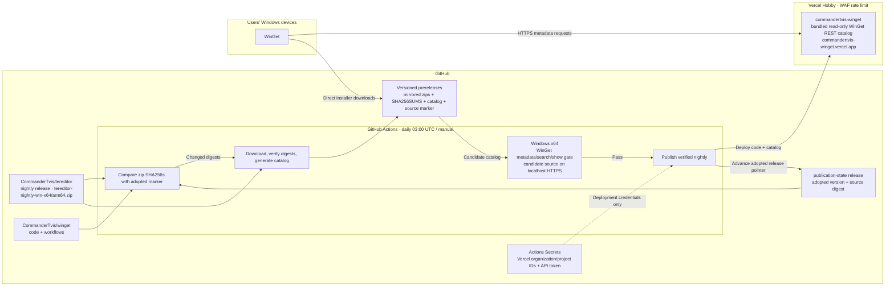

## Infrastructure

### Hosting acceptance criteria

The host is Vercel Hobby with its provided `vercel.app` hostname.
A thin Node.js Function entry point uses the existing REST handler and bundled
adopted catalog; the persistent source identifier remains unchanged. GET and HEAD
at the root serve the generated static installation page with its security headers.
Other requests retain REST method, body-size, version, and query validation.

Before switching nightly publication, verify the deployed public hostname,
information, search, every package manifest, invalid requests, and static page.
Configure the project's WAF rate limiter to return 429 before function execution;
browser challenges must not gate WinGet. Keep qualification ahead of production
deployment and do not enable automatic Git production deployments that could
publish an unqualified catalog. Deployment credentials remain CI-only.

Existing installations using a different URL must remove and re-add their WinGet
source with the Vercel URL.
Accepted requests can still exhaust Vercel's free allowance; this hosting setup does
not promise quota isolation across other Vercel projects.



Vercel serves metadata and the installation page; binary downloads go directly to GitHub.
The Windows gate precedes publication to the production source. Deployment credentials
stay in CI and are not bound to the Function.

## Boundaries

The root path serves a responsive HTML installation guide with package availability
from the catalog. The build generates a static asset and bundles the REST handler
for Node.js. Vercel routes GET and HEAD at the root directly to the asset without
invoking the Function. Other requests route to the Function. Route headers retain
the page's content security policy and MIME sniffing protection.
It uses a single document column with browser-default typography, colors, and
spacing. Only long command and code wrapping uses CSS, so the page fits narrow
screens. It requires no JavaScript or external assets.

The REST endpoints remain dynamic: `/information` validates protocol headers,
manifest lookup filters version/channel query parameters, and search processes a
POST body. Unmatched requests fall through to the Function, preserving JSON
errors and method validation. The local Windows qualification server uses the
same page renderer and REST implementation.

A read-only Vercel Function serves a bundled WinGet REST catalog on `vercel.app`.
GitHub Releases serve installer bytes. The Function has no database, runtime GitHub
API dependency, upload endpoint, or runtime secrets; a catalog change is a Vercel
deployment. This keeps metadata and code together and avoids eventually consistent
multi-key publication.

GitHub Actions writes immutable `catalog.json` and `source.sha` assets to each nightly
release. The `publication-state` release body is a single JSON adoption pointer
containing `version` and `sourceSha`; it advances only after public-source verification.
`sourceSha` is the SHA256 of the two mirrored zips' hex digests, x64 then ARM64, one per
line. States adopted while the ThinkRail fork was built hold a 40-hex fork commit instead;
the parser accepts both, and an old commit never equals the marker, so the first
Tereditor-only run publishes.
Nightly publication never commits or pushes to a branch.
An ignored local `catalog.json` is the build input; it is bundled into Vercel.
Local checks initialize a missing catalog to an empty bootstrap; deployment refuses
an empty catalog. API errors, corrupt adoption state, and absent state stop
comparisons and catalog downloads.

The source implements Microsoft's REST 1.4 contract, the first supporting portable
and nested ZIP installers.

## Tereditor package

`CommanderTvis.Tereditor` has x64 and ARM64 installers in one package identity. The check
job reads the SHA256 digests GitHub reports for `tereditor-nightly-win-x64.zip` and
`tereditor-nightly-win-arm64.zip` in `CommanderTvis/tereditor`'s mutable `nightly`
release. The release job downloads both, refuses them unless their bytes match the
checked digests, and copies them into the versioned prerelease as
`tereditor-windows-<arch>.zip`, so the catalog's URLs and SHA256s stay immutable. Each is
a nested portable zip (`client\tereditor.exe`) without a command alias. Nothing is
built here. The adopted-catalog validator requires a `CommanderTvis.Tereditor` package, or
`CommanderTvis.SharpRail` in catalogs adopted before the rename.

## Dropped ThinkRail fork packages

`CommanderTvis.ThinkRail` (x64/ARM64 CLI) and `CommanderTvis.ThinkRail.Desktop` were
built here from `CommanderTvis/thinkrail` and are no longer published. Their last
adopted catalog stays loadable because the validator still accepts extra packages that
share the adopted version. The `desktop-updates` release that installed fork desktops
poll is left frozen; nothing writes to it any more.

## Dropped JetBrains stable packages

`CommanderTvis.JetBrainsThinkRail` and `CommanderTvis.JetBrainsThinkRail.Desktop` used to
link JetBrains' stable release in place. They are no longer generated because the CLI ships
in the community `winget` source as `JetBrains.ThinkRailCLI`. The adopted-catalog validator
still exempts any `JetBrains` identifier from the nightly-version check so catalogs adopted
before the removal stay loadable; drop that exemption once no adopted catalog carries them.

## Publication invariants

Installer URLs identify an immutable GitHub prerelease and SHA256 checksums cover
the published bytes. Empty initial metadata advertises no fake builds. Only the
latest successfully adopted nightly is indexed; old releases remain available on
GitHub.

Windows qualification uses the candidate catalog before production publication.
WinGet metadata/search/show validation of Tereditor on x64 is a hard gate; ARM64 has
no runner gate.
Automated verification does not install Tereditor. A download, digest, manifest, or
required qualification failure must not advance the production catalog or source
marker. Publication across GitHub and Vercel is not transactional: once a release may
have been adopted, cleanup must retain its downloads rather than break installed
catalogs.

## Trust

These nightlies are unsigned. Checksums protect download integrity but do not
provide publisher signing or bypass Windows SmartScreen. Source addition is an
explicit trust decision. Automation must not bypass Windows security or simulate
clicking “Run anyway”. Runtime source endpoints never mutate data.

## Verification boundary

Protocol and publication helpers have local tests. WinGet metadata/search/show checks
belong on a Windows runner; they do not establish Tereditor installation or upgrade
success. A macOS check cannot establish Windows behavior. Live deployment and the
first hosted nightly remain operator actions unless separately authorized.

## Deployment

The public source is `https://commandertvis-winget.vercel.app`. The project is
`commandertvis-winget` in the `commandertvis` Hobby team; no personal domain is needed.
Production is public so WinGet requires no Vercel authentication. Automatic Git
integration is not connected: only qualified catalogs may reach production.

`.vercelignore` allows only the API entry point, source, build scripts, dependency
files, adopted catalog, and Vercel configuration into deployment uploads. Downloaded
release artifacts stay on GitHub; uploading them to Vercel exceeds its file-size
limit. Vercel generates `dist/` during its build rather than uploading local output.

1. Install dependencies with `bun install --frozen-lockfile`, then run
   `bun run check` and `bun run build`.
2. Authenticate with `bunx vercel@62.1.0 login` and link the existing project with
   `bunx vercel@62.1.0 link --yes --project commandertvis-winget`.
   Keep `.vercel/` and `.env*` local and ignored. Do not connect automatic Git
   deployments.
3. Download the adopted catalog with `bun run catalog:adopted`, then deploy with
   `bun run deploy`. Verify it using
   `bun scripts/verify-source.ts https://commandertvis-winget.vercel.app`.
   The Vercel Function imports a Bun-generated Node.js bundle, avoiding runtime
   TypeScript imports and extensionless module resolution.
4. Configure GitHub Actions secrets `VERCEL_ORG_ID`, `VERCEL_PROJECT_ID`, and
   `VERCEL_TOKEN`. Scope the API token to the owning team and, where supported,
   this project. Never store the token in source files. Nightly CI passes it
   explicitly to the CLI, deploys after qualification, then checks the public
   source before adopting metadata.
5. The project's active WAF rule limits all paths to 120 requests per IP per
   60-second fixed window and returns 429 when exceeded. Automatic DDoS
   mitigations are active; Attack Mode and browser bot challenges are off so
   WinGet remains usable. Review changes with `vercel firewall diff` and publish
   them with `vercel firewall publish`. NAT users share the per-IP allowance.
6. Run the hosted Nightly workflow after the changed workflow reaches main.
   The x64 WinGet metadata gate remains mandatory. Tereditor WinGet installation
   remains manual and unverified.

[WAF-mitigated traffic](https://vercel.com/docs/vercel-firewall/vercel-waf/usage-and-pricing)
does not consume CDN requests or fast data transfer. Accepted requests still
consume [Hobby allowances](https://vercel.com/docs/plans/hobby), and a distributed
attack can evade per-IP limits. This is mitigation, not guaranteed availability
or isolation from other projects on the same Vercel team. GitHub downloads do
not traverse the Function.

## Operation and recovery

### Traffic notifications

The free `Source traffic alert` workflow polls Vercel firewall counters every
15 minutes, using the existing project ID and token secrets. It fails when the
last 15 minutes contain at least 1,000 accepted requests or 100 blocked requests,
or when the last 24 hours contain at least 10,000 accepted requests. This catches
both bursts and sustained allowance consumption. Missing or invalid metrics and
failed API queries also fail the monitor rather than reporting a healthy result.

Enable GitHub Actions email notifications with failed runs only at
`https://github.com/settings/notifications`. Scheduled-run notifications go to
the user who last modified the cron schedule. The workflow becomes active only
after it reaches the default branch; verify notification delivery with a manual
run. It does not create issues or send Slack messages. Alerting can repeat while
the thresholds remain exceeded.

GitHub schedules and Vercel metrics can be delayed, so this is best-effort polling,
not a real-time notification guarantee or an automatic shutdown. It does not
measure CPU or transfer allowance. Vercel's separate built-in usage-anomaly
alerts require a paid plan; its standard quota notifications are independent.

Nightlies run daily at 03:00 UTC or manually, skip unchanged Tereditor zips by
comparing their combined SHA256 marker against `sourceSha` in the `publication-state` release body,
and use `0.0.0-nightly.<UTC YYYYMMDDHHmmss>` versions. A manual dispatch with
`force=true` republishes anyway. Change `scripts/catalog.ts`, not generated catalog
entries.

Publication order is the immutable prerelease download, the candidate qualification
gate, Vercel deployment and public-source verification, then an update to the
`publication-state` release body.

On download, digest, or required qualification failure, production stays unchanged
and cleanup removes the unadopted prerelease. After a partial publication failure,
retain downloads, fix the cause, and start a new workflow run. The unchanged adopted
digest makes it retry. Do not
rerun only the failed validation job after cleanup has removed its candidate downloads.

For source-only fixes, use up-to-date `main` and run `bun run catalog:adopted`
before deploying, outside an active nightly run. An old local catalog would
roll back advertised packages; the deployment command rejects an empty catalog. Keep old release downloads even though WinGet indexes only the latest
adopted nightly.

### Publication state

The pointer is one release-body update, so readers cannot observe a catalog and digest
from different publications. A failed pointer update retains the prior state. The state
release is mutable and must not have release immutability enabled. No job has persisted
checkout credentials or writes to a Git branch.

## Maintainer verification

```sh
bun install --frozen-lockfile
bun run check       # strict TypeScript, Biome, and unit tests
bun run build       # static page + Node.js bundle, no deployment
bun run dev         # local Vercel development
bun run catalog:adopted # download adopted metadata for local inspection/deployment
```

`Check` CI also runs actionlint and PowerShell parsing/PSScriptAnalyzer.
`scripts/test-install.ps1` is destructive and restricted to disposable hosted Windows
runners. Its HTTPS source uses an IPv4 loopback URL and a temporarily trusted
certificate with the matching IP-address SAN, avoiding localhost IPv6 resolution
against an IPv4-only listener. Readiness failures retain their underlying exception;
certificate verification is never skipped. It validates Tereditor metadata, search,
and show only, and never installs a package.

When WinGet is unavailable, bootstrap pins the PowerShell module to `1.29.280` and
requests GitHub release tag `v1.29.290` for the current runner user. The repair module
passes the supplied tag verbatim when registering a provisioned package: omitting
`v` causes a GitHub 404. Unversioned repair can also infer a nonexistent release from
a provisioned Store package. PowerShell Gallery module versions and WinGet CLI release
versions are independent; verify that both pins exist in their respective registries.
All-users provisioning is unnecessary for these checks.

Protocol reference: [Microsoft WinGet REST 1.4](https://github.com/microsoft/winget-cli-restsource/blob/main/documentation/WinGet-1.4.0.yaml).
Hosting reference: [Vercel Node.js Functions](https://vercel.com/docs/functions/runtimes/node-js).
